# Sweety – Blood Glucose Tracker

Sweety is a web application for recording and managing blood glucose readings. Users can track their daily readings, view their reading history, and review statistics through daily and monthly reports.

## Features

### Authentication
- User registration with name, email and password.
- User login.
- Password hashing using bcrypt.
- JWT-based authentication.
- User-specific reading access.

### Blood Glucose Readings
- Add, view, edit and delete readings.
- Record readings in mg/dL.
- Four daily reading slots:
  - Morning (fasting)
  - After breakfast
  - After lunch
  - After dinner
- Prevent duplicate readings for the same date and time slot.
- Maximum of four readings per day.
- Validate glucose values between 40 and 600 mg/dL.
- Paginated reading history.

### Dashboard

- Today's summary statistics (average, highest, lowest and total readings).
- Daily reading slot status.
- Overview of the four daily reading slots: Morning, After Breakfast, After Lunch and After Dinner.

### Reports
- **Daily Report:** Shows readings for the selected date, including individual reading slots, highest, lowest, average and total readings.
- **Month-to-Date Report:** Covers the first day of the selected month through the selected date.
- **Previous Month Report:** Covers the complete previous calendar month.
- **Monthly Glucose Chart:** Visualizes glucose readings throughout the selected month.

## Tech Stack

### Frontend
- React 19
- TypeScript
- Vite
- Tailwind CSS v4
- Axios
- React Router
- Lucide React

### Backend
- Node.js
- Express 5
- TypeScript
- JWT
- bcrypt
- Zod

### Database
- PostgreSQL 18
- pg

## Project Structure

```text
sweety/
├── client/
│   ├── src/
│   │   ├── assets/
│   │   ├── components/
│   │   ├── context/
│   │   ├── pages/
│   │   └── services/
│   └── .env.example
│
├── server/
│   ├── src/
│   │   ├── auth/
│   │   ├── database/
│   │   │   ├── connection.ts
│   │   │   ├── schema.sql
│   │   │   └── seed.ts
│   │   ├── readings/
│   │   ├── reports/
│   │   ├── routes/
│   │   ├── types/
│   │   └── index.ts
│   └── .env.example
│
└── README.md
```

## Requirements

- Node.js
- npm
- PostgreSQL 18

## Installation

### 1. Clone the repository

```bash
git clone https://github.com/aestheticwolf/sweety-blood-glucose-tracker.git
```

Navigate to the project directory:

```bash
cd sweety-blood-glucose-tracker
```

### 2. Install backend dependencies

```bash
cd server
npm install
```

### 3. Install frontend dependencies

Open another terminal from the project root:

```bash
cd client
npm install
```

## Database Setup

Sweety uses PostgreSQL 18 for data storage.

### 1. Start PostgreSQL

Ensure your PostgreSQL server is running.

### 2. Create the database

Connect to PostgreSQL using pgAdmin or `psql` and run:

```sql
CREATE DATABASE sweety_db;
```

### 3. Apply the database schema

From the project root, execute:

```bash
psql -U postgres -d sweety_db -f server/src/database/schema.sql
```

This creates the required tables, constraints and indexes.

### 4. Seed demo data (optional)

After configuring `server/.env` and applying `schema.sql`, you can populate a demo account and sample readings spanning today, the current month, and the previous calendar month:

```bash
cd server
npm run seed
```

Demo account credentials (for local evaluation and testing only):
- **Email:** `demo@sweety.app`
- **Password:** `SweetyDemo@123`

The seed script hashes the password with bcrypt and safely skips duplicate records if run multiple times.

### Database Schema

#### users

Stores user account information.

- `id`: UUID primary key
- `name`: User name
- `email`: User email address
- `password_hash`: Hashed password
- `created_at`: Account creation timestamp

Email addresses are unique regardless of letter case.

#### readings

Stores blood glucose readings associated with users.

- `id`: UUID primary key
- `user_id`: References the user
- `reading_date`: Date of the reading
- `slot`: Reading time slot
- `value`: Glucose value in mg/dL
- `created_at`: Record creation timestamp
- `updated_at`: Record update timestamp

Database constraints enforce valid reading slots, glucose values between 40 and 600 mg/dL, and prevent duplicate readings for the same user, date and slot.

Deleting a user also deletes their associated readings.

An index is created on the user ID and reading date to support reading history retrieval.

## Environment Configuration

Example templates are provided in `server/.env.example` and `client/.env.example`.

### Backend (`server/.env`)

Create a `.env` file inside the `server` directory:

```env
PORT=5000

DB_HOST=localhost
DB_PORT=5432
DB_NAME=sweety_db
DB_USER=postgres
DB_PASSWORD=your_postgresql_password

JWT_SECRET=your_jwt_secret
```

Replace the example values with your local PostgreSQL configuration and a secure JWT secret.

### Frontend (`client/.env`)

Create a `.env` file inside the `client` directory:

```env
VITE_API_URL=http://localhost:5000/api
```

`VITE_API_URL` sets the base API URL used by Axios in `client/src/services/api.ts` (matching the default backend port `5000`).

Do not commit your actual `.env` files or expose credentials.

## Server Setup and Run

Open a terminal and navigate to the server directory:

```bash
cd server
```

Install dependencies:

```bash
npm install
```

Start the development server:

```bash
npm run dev
```

The server uses `tsx watch` to run TypeScript in development mode.

### Backend Scripts

| Command | Description |
|---|---|
| `npm run dev` | Run the development server with file watching |
| `npm run start` | Start the server using tsx |
| `npm run build` | Compile TypeScript |
| `npm run typecheck` | Check TypeScript without generating output |
| `npm run seed` | Seed a demo user and sample readings for local testing |

## Client Setup and Run

Open a separate terminal and navigate to the client directory:

```bash
cd client
```

Install dependencies:

```bash
npm install
```

Start the frontend development server:

```bash
npm run dev
```

Vite will display a local development URL in the terminal. Open that URL in your browser to access Sweety.

### Frontend Scripts

| Command | Description |
|---|---|
| `npm run dev` | Start the Vite development server |
| `npm run build` | Type-check and create the production build |
| `npm run lint` | Run ESLint |
| `npm run preview` | Preview the production build |

## Testing and Verification

Automated unit or integration tests are not currently implemented in this project.

### Available Verification Commands

Backend (`cd server`):

```bash
npm run typecheck
npm run build
```

Frontend (`cd client`):

```bash
npm run lint
npm run build
```

### Manual Functional Testing

Start PostgreSQL, configure `server/.env` and `client/.env`, and run `npm run dev` in both `server/` and `client/` to manually verify registration, login, user isolation, reading CRUD and validation rules, and the Daily, Month-to-Date, and Previous Month reports (using either a new account or the optional demo account from `npm run seed`).

## Validation Rules

- A glucose value is required.
- Glucose values must be whole numbers.
- Values must be between 40 and 600 mg/dL.
- Only one reading is allowed per time slot for each date.
- A maximum of four readings is allowed per day.
- Reading dates cannot be in the future.

## Notes

- Each user can access only their own blood glucose readings.
- Readings are stored with a date and time slot.
- PostgreSQL is used for persistent data storage.
- Protected application features require authentication.
- Reading validation is implemented in the application, with database constraints enforcing important data integrity rules.

## Assumptions

- Blood glucose readings are recorded in mg/dL.
- The four daily slots are Morning (fasting), After breakfast, After lunch and After dinner.
- Each time slot can contain only one reading per day for a user.
- A maximum of four readings can be recorded per day.
- The Daily report uses the selected date.
- The Month-to-Date report covers the first day of the month through the selected date.
- The Previous Month report represents the previous complete calendar month.

## Improvements With More Time

- Add reminder notifications for scheduled glucose readings.
- Improve reporting with options to export reports.
- Enhance accessibility and responsiveness across different devices.
- Add automated backend and frontend tests to improve reliability.

## Screenshots

### Authentication

#### Login
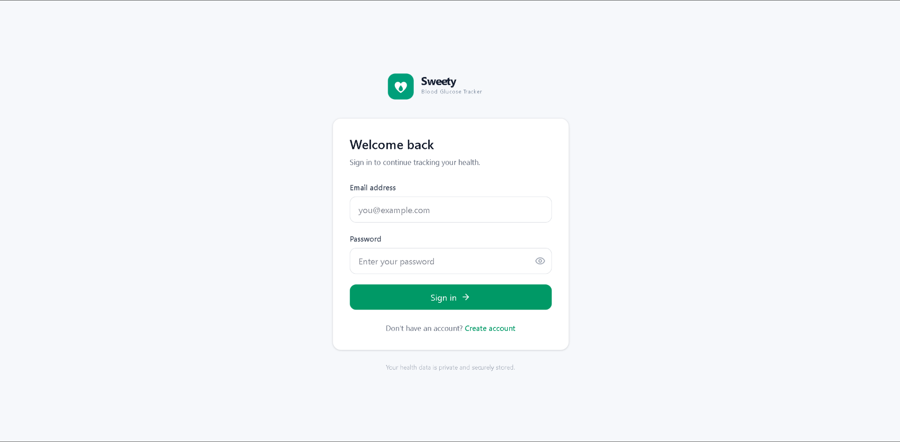

#### Sign Up
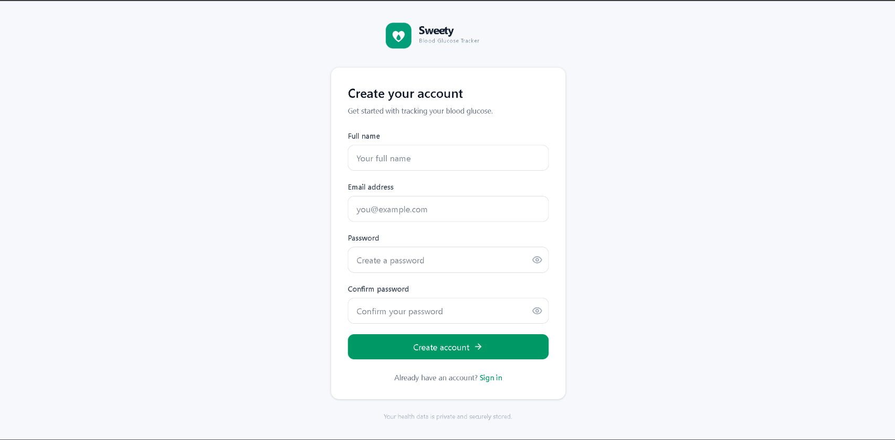

### Dashboard

#### Main Dashboard
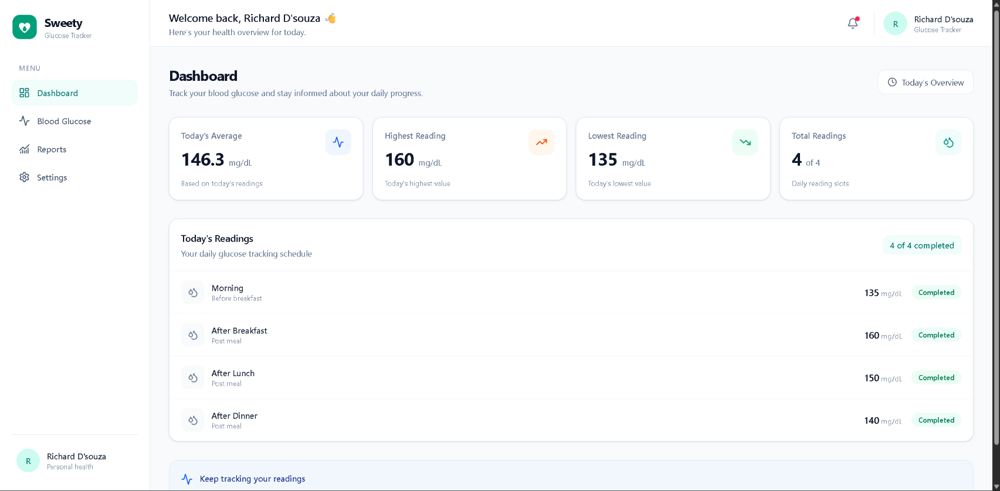

### Blood Glucose Management

#### Blood Glucose Readings
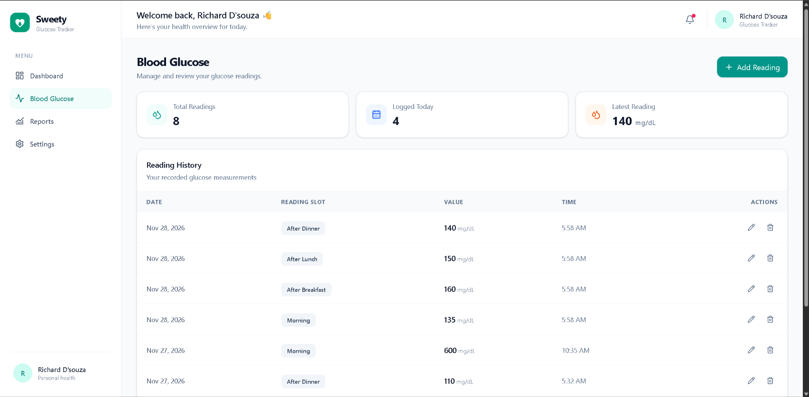

#### Add Reading
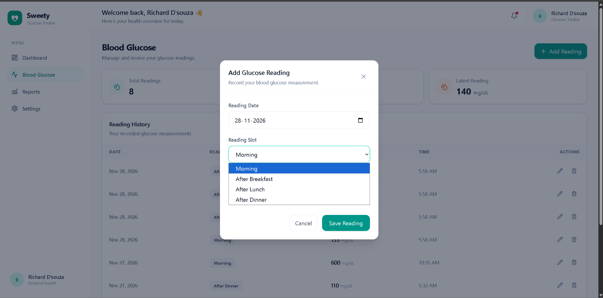

#### Add Glucose Reading
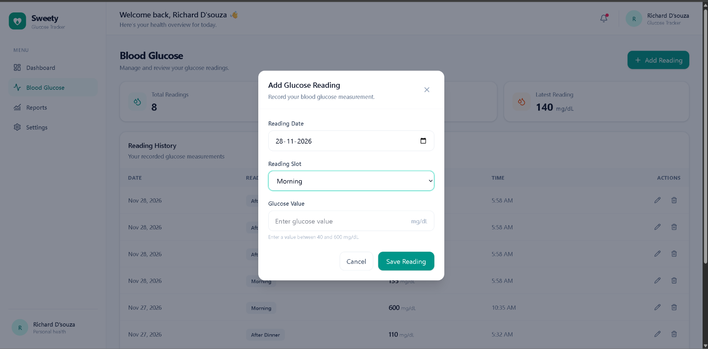

#### Update Reading
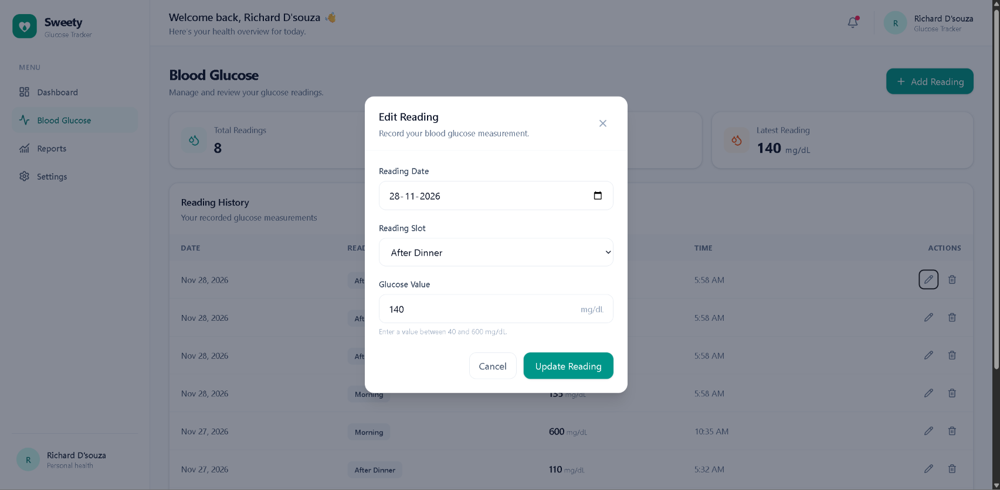

### Reports & Analytics

#### Daily Report
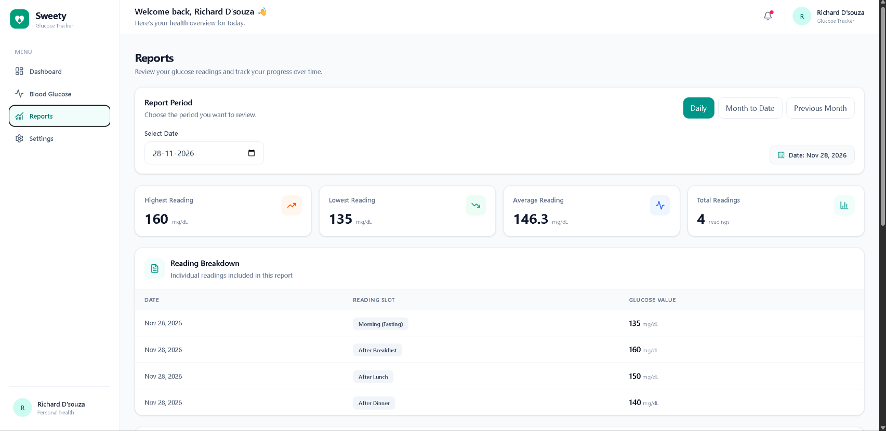

#### Month-to-Date Report
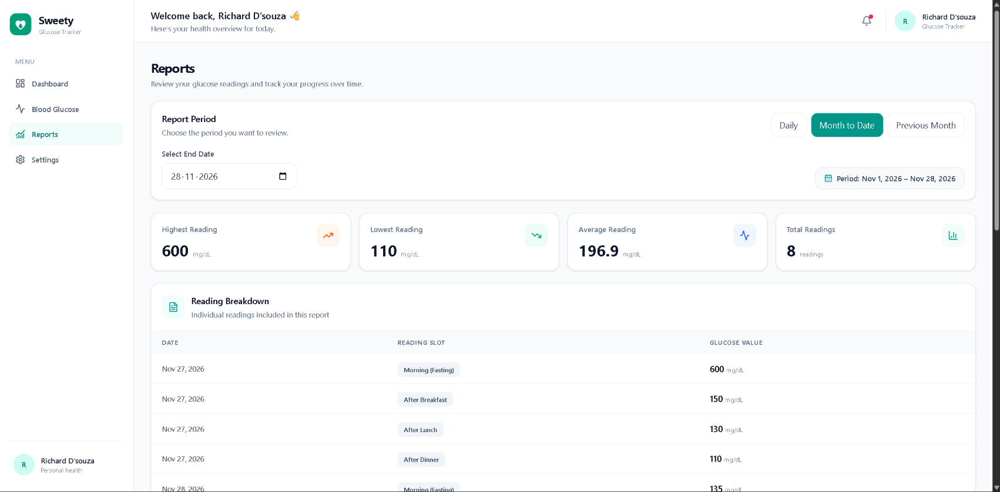

#### Previous Month Report
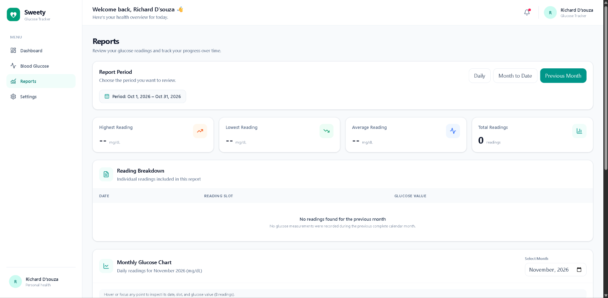

#### Monthly Glucose Chart
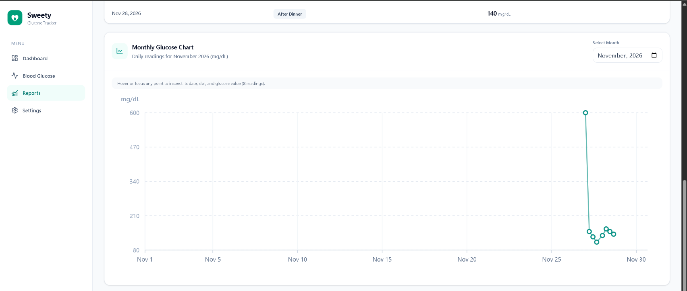

### Pagination

#### Reading Pagination with Seed Data
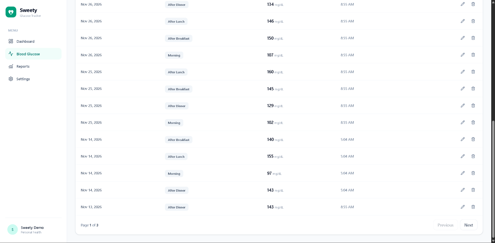
